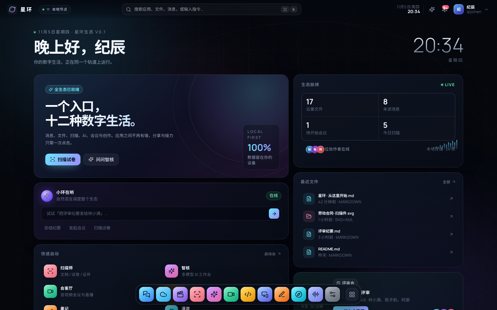
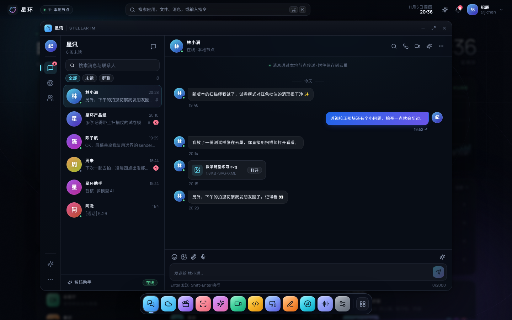
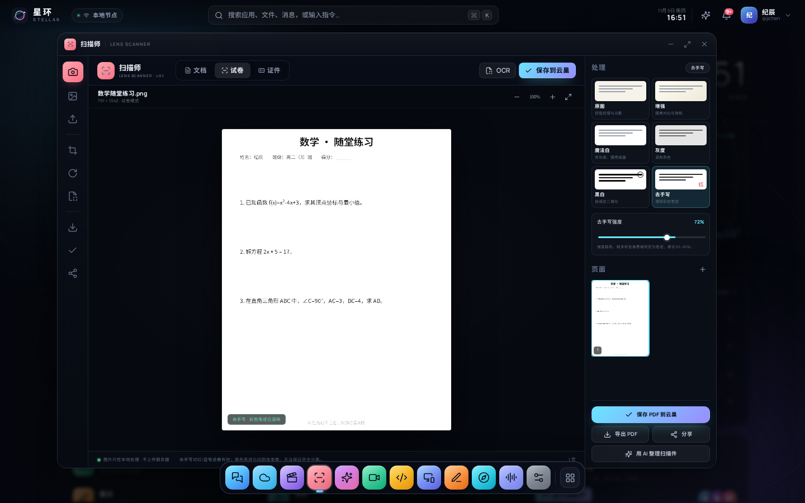
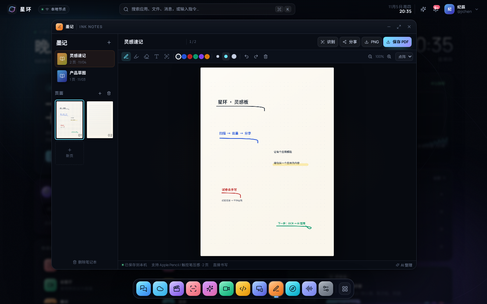
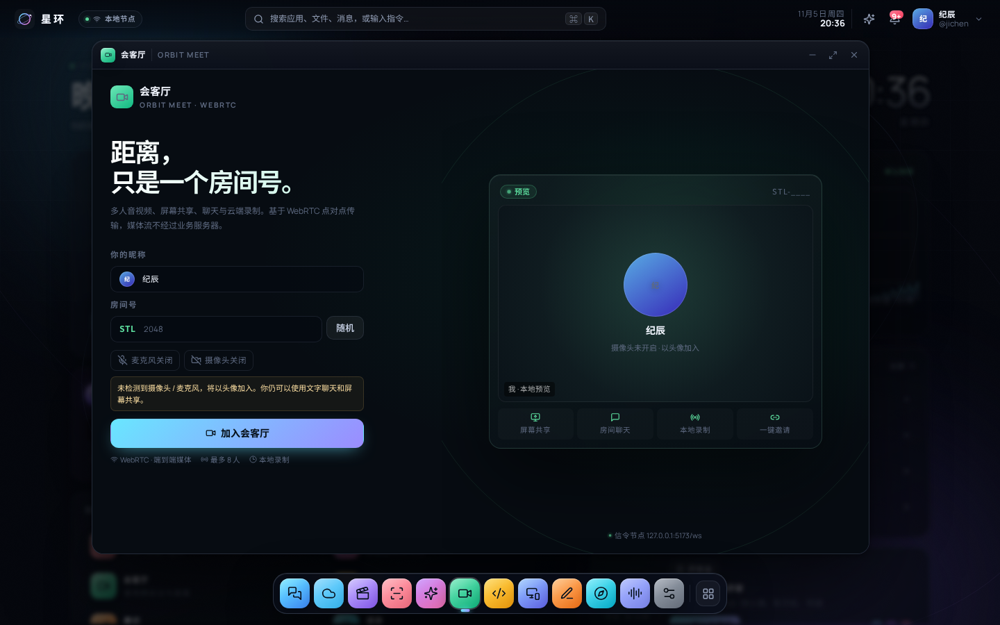
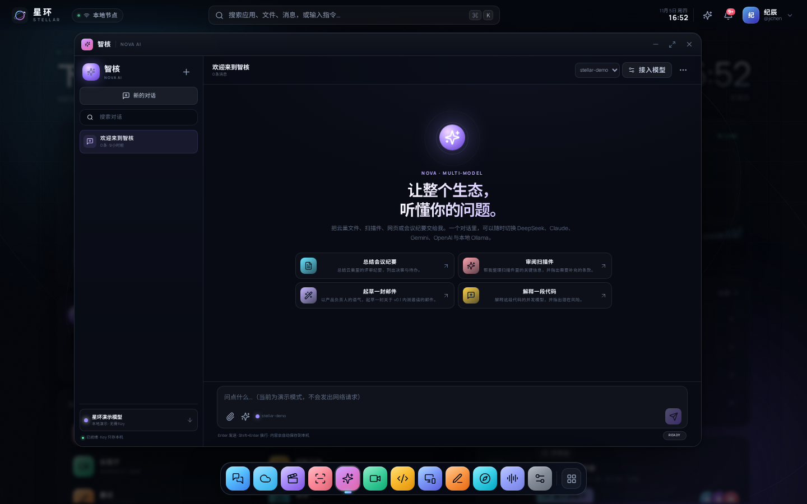
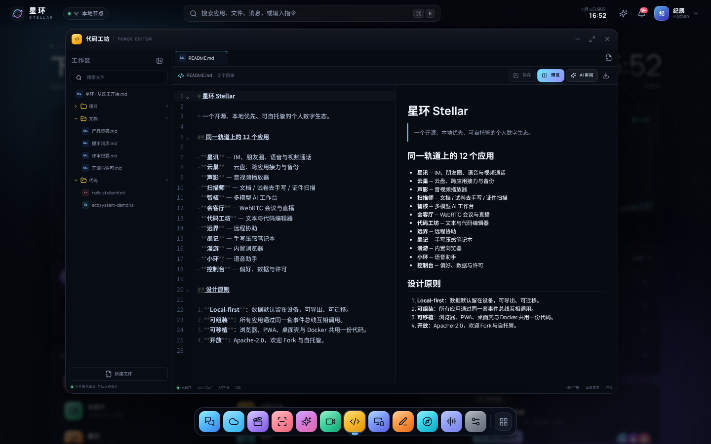
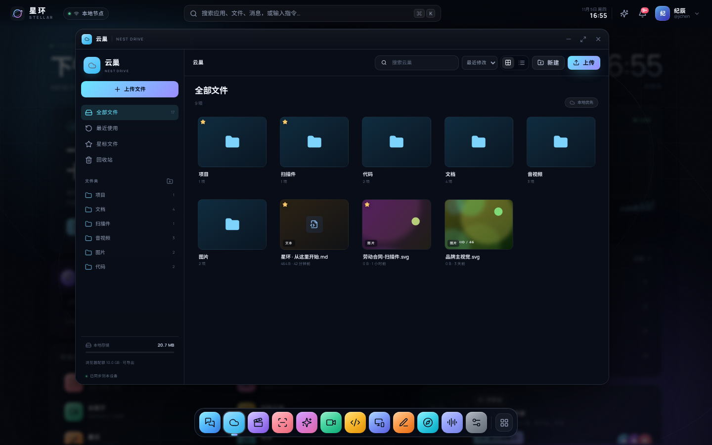

# 星环 Stellar · 全生态工作空间

> 一个开源、本地优先、可自托管、跨平台可移植的个人数字生态。  
> 12 个应用共享同一套窗口系统、文件存储、事件总线与身份——不是应用合集，而是一个能互相调用的整体。

<p align="center">
  
</p>

## 界面预览

| 桌面 · 一个入口 | 星讯 · 消息与朋友圈 |
| --- | --- |
|  |  |
| **扫描师 · 试卷去手写** | **墨记 · 压感手写** |
|  |  |
| **会客厅 · WebRTC** | **智核 · 多模型** |
|  |  |
| **代码工坊 · 编辑与预览** | **云巢 · 本地文件** |
|  |  |

更多截图（朋友圈、远界、漫游、小环、裁剪）在 [docs/screenshots](docs/screenshots)。

## 为什么是「一套生态」

普通工具箱里的应用彼此隔离；星环里的每个应用都能把内容交给另一个应用：

```ts
// 扫描仪：把 PDF 存进云巢，再交给星讯发送
const file = await ecosystem.saveFile({
  name: '劳动合同.pdf',
  mime: 'application/pdf',
  blob: pdfBlob,
  folderName: '扫描件',
  sourceApp: 'scanner',
})
ecosystem.open('im', { chatId: 'chat-lin' })
ecosystem.sendFileToChat(file.id, 'chat-lin')

// 任意应用：把当前内容交给 AI
ecosystem.askAI({
  prompt: '总结这份会议纪要，提取决策与待办',
  context: noteText,
  origin: 'meeting',
  autoSend: true,
})

// 系统级通知 + 跨应用跳转
ecosystem.notify('扫描师', '扫描件已保存', { appId: 'drive', params: { folderId: 'folder-scans' } })
```

统一入口：**应用坞 / 启动台 / 指令中心（⌘K）/ 小环语音助手 / 分享面板 / 生态通知中心 / 深链接**。

## 应用矩阵

| 应用 | 英文名 | 能力 |
| --- | --- | --- |
| **星讯** | Stellar IM | 消息、群聊、文件卡片、语音消息、图片、朋友圈、点赞评论、语音/视频通话界面（本地媒体预览 + 可升级到会客厅） |
| **云巢** | Nest Drive | 本地优先云盘、文件夹、上传/下载、搜索、星标、回收站、图片/PDF/文本预览、跨应用「打开方式」 |
| **声影** | Echo Player | 音视频播放、播放列表、进度/音量/倍速/循环/随机、全屏、画中画、VTT 字幕、拖拽导入 |
| **扫描师** | Lens Scanner | 拍照/导入/**Ctrl+V 粘贴截图**、**自动识别页面四角**、四点透视裁剪、魔法白/增强/灰度/黑白、**红蓝笔迹去手写**、**黑笔框选清除**、锐化、**扫描白底 + 智能高清 2×**、证件模式与水印、OCR、原图对比/归档、PNG/PDF 导出 |
| **智核** | Nova AI | OpenAI 兼容 / Anthropic / Gemini / Ollama / 演示模型，流式输出、模型切换、系统提示词、云巢上下文、会话历史、API Key 本地配置 |
| **会客厅** | Orbit Meet | 基于 WebRTC 的多人会议、房间号、屏幕共享、成员状态、房间聊天、本地录制并存入云巢 |
| **代码工坊** | Forge Editor | CodeMirror 6、多标签、文件树、Markdown/HTML 预览、语法高亮、搜索、保存到云巢、AI 审阅 |
| **远界** | Remote Desk | 屏幕共享、P2P 指针同步、剪贴板、截图、会话码、活动日志；桌面代理可扩展为 OS 级输入注入 |
| **墨记** | Ink Notes | 压感手写、钢笔/荧光笔/橡皮/文字、撤销重做、四种纸张、多页/多笔记本、PNG/PDF、云巢归档 |
| **漫游** | Drift Browser | 多标签、地址栏、前进后退、书签、起始页、页面 AI 摘要、系统浏览器打开；桌面壳可替换为原生 WebView |
| **小环** | Halo Assistant | Web Speech 语音识别/播报、自然语言跨应用指令、本地命令解析、AI 兜底 |
| **控制台** | Control | 外观/壁纸/强调色/身份、多模型 API、存储用量、完整 Zip 备份与恢复、演示数据重置、开源许可 |

> 受浏览器安全模型限制的能力（跨站 iframe、OS 级远控输入、原生摄像头权限）在 UI 中都有明确标注，不伪装成已实现。

## 架构

```text
┌──────────────────────────── Stellar Shell ────────────────────────────┐
│ Top Bar · Window Manager · Dock · Command Palette · Notifications     │
│ Share Sheet · Launcher · Toasts · Deep Links                          │
├──────────────────────────────────────────────────────────────────────┤
│ IM   Drive   Scanner   AI   Meet   Editor   Remote   Notes   Browser  │
│                    Assistant        Settings                          │
├──────────────────────────────────────────────────────────────────────┤
│ Ecosystem SDK                                                         │
│ open() · openFile() · share() · saveFile() · askAI() · sendFileToChat()│
├──────────────────────────────────────────────────────────────────────┤
│ Zustand store (persisted)   IndexedDB (blobs)   AI provider adapters  │
│ WebRTC mesh + Node/ws signaling   Tesseract OCR   jsPDF / JSZip       │
└──────────────────────────────────────────────────────────────────────┘
```

- **Shell**：桌面壁纸、顶栏、可拖拽/缩放/最大化窗口、Dock、启动台、指令中心、通知、分享、Toast。
- **Core**：类型、应用注册表、持久化 Store、IndexedDB Blob 存储、生态 SDK、多模型流式客户端。
- **Server**：Express + `ws`，负责静态托管、WebRTC 信令、房间与状态广播、健康检查。
- **Desktop**：`apps/desktop` 提供 Electron 壳（可选，不参与 pnpm workspace 默认安装）。

更多细节：[docs/ARCHITECTURE.md](docs/ARCHITECTURE.md) · SDK：[docs/APP-SDK.md](docs/APP-SDK.md)

## 快速开始

要求：Node.js **22+**、pnpm **10/11**。

```bash
pnpm install
pnpm dev
```

- Web / PWA：<http://127.0.0.1:5173>
- 信令 + 健康检查：<http://127.0.0.1:8787/api/health>
- WebSocket：`ws://127.0.0.1:8787/ws`（Vite 已代理 `/ws`）

生产构建与单进程托管：

```bash
pnpm build
pnpm start            # http://127.0.0.1:8787
```

Docker：

```bash
docker compose up --build
# 打开 http://127.0.0.1:8787
```

### PWA / 跨平台

- 浏览器访问后使用「安装应用」即可作为 PWA 安装到 Windows / macOS / Linux / Android / iOS。
- 移动端 Shell 自动切换为全屏窗口 + 精简 Dock。
- 同一份代码提供 Docker 自托管；桌面外壳见 [apps/desktop/README.md](apps/desktop/README.md)。
- 所有业务数据默认留在本机浏览器（IndexedDB + localStorage），可通过控制台导出完整备份并迁移。

## 配置 AI 模型

1. 打开 **智核 → 接入模型** 或 **控制台 → AI 模型**。
2. 选择提供方，填写 Base URL、API Key、模型名（如 `deepseek-chat`、`claude-sonnet-4-5`、`gemini-2.5-flash`）。
3. 点击「测试连接」，成功后「设为当前」。

支持：

- OpenAI 兼容端点（OpenAI、DeepSeek、Moonshot、硅基流动、自建网关等）
- Anthropic Messages API
- Google Gemini `streamGenerateContent`
- Ollama 本地推理（默认 `http://localhost:11434`）
- 内置**演示模型**：完全离线，用于体验流程，不发送网络请求

> ⚠️ API Key 保存在浏览器本地存储中，并由浏览器直连服务商。生产部署建议增加同源服务端代理，避免把 Key 暴露给最终用户。部分服务商可能因 CORS 拒绝浏览器直连。

## WebRTC 会议与远控

- 会议默认使用公共 STUN（Cloudflare / Google）组建 P2P mesh，最多 8 人。
- 跨运营商/严格 NAT 场景需要 TURN。设置环境变量后重启服务端：

```bash
TURN_URL=turn:turn.example.com:3478 \
TURN_USERNAME=stellar \
TURN_CREDENTIAL=change-me \
pnpm start
```

- 局域网/公网多设备测试时，请通过 **HTTPS** 或 `localhost` 访问，否则浏览器会禁用摄像头、麦克风与屏幕共享。
- 远界 Web 版只同步指针、剪贴板与截图；**OS 级键鼠注入**需要桌面代理（Electron + 原生输入模块）。UI 与文档不会把这一限制藏起来。

## 扫描算法与边界

- **透视校正**：四点单应性变换（homography），逐像素重采样。
- **魔法白**：按亮度分位数估计纸张底色，白平衡 + 对比增强。
- **黑白**：积分图自适应阈值，适合文字文档。
- **试卷去手写**：默认仅处理红/蓝（含品红）笔迹及抗锯齿边缘，**其他像素保持原样**；可选择「所有彩色」范围。不会整页灰度化。
- **印刷体保护**：对暗色印刷核心做小半径膨胀保护，避免暖光环境下的黑字边缘被误判为红笔。
- **非破坏式**：处理结果写回副本，原始页保留；默认同时归档一份原图 PDF。
- **黑笔框选**：手动框选手写区域后清除；因黑手写与印刷同色，框内印刷也会被清除。需要绝对保真时请用「原图」或原图 PDF。
- **OCR**：Tesseract.js 中英文模型，首次使用需要从 CDN 下载语言包（约 10–15 MB）；图片不会上传。
- **证件**：导出 PDF 时按证件模式叠加自定义斜向水印。

> 去手写优先针对彩色笔迹。黑色墨水与印刷体在像素层面高度重合，纯视觉算法无法保证 100% 分离；因此黑笔采用**手动框选**而不是全自动，避免误删整页印刷。低饱和红笔或与印刷体重叠的笔迹可能残留，建议导出前先核对。所有图像处理在本地 Canvas / Web Worker 中完成。

## 内置浏览器说明

Web 端使用 `<iframe>`，目标站点可通过 `X-Frame-Options` / CSP 禁止嵌入。漫游会提前提示常见受限站点，并提供「在系统浏览器打开」与「仍然尝试嵌入」。桌面壳使用原生 WebView 时不受该限制。页面 AI 摘要无法跨域读取正文，提示词与 UI 均如实说明。

## 数据、隐私与开源

- 默认无遥测、无账号、无中心服务器；文件 Blob 在 IndexedDB，元数据在 localStorage。
- 控制台支持导出**完整 Zip 备份**（元数据 + 所有 Blob）与恢复。
- 备份包含 AI Key 配置；分享备份前请先清除密钥。
- 许可证：**Apache-2.0**（见 [LICENSE](LICENSE)）。免责与第三方许可见 [THIRD_PARTY_NOTICES.md](THIRD_PARTY_NOTICES.md)。
- 本项目与微信、腾讯会议、ToDesk、扫描全能王无任何关联；未使用其商标、图标或私有资源，所有演示图由代码实时生成。

## 项目结构

```text
apps/
  web/                 React 19 + Vite + TS 前端
    src/core/          类型、Store、IndexedDB、SDK、AI 客户端、种子数据
    src/components/    Shell、窗口、Dock、指令中心、分享面板等
    src/apps/          12 个应用（按目录隔离，懒加载）
    public/            PWA manifest / SW / 图标
  server/              Express + ws 信令与静态托管
  desktop/             Electron 壳（可选）
docs/                  架构、部署、SDK、安全、截图
Dockerfile
docker-compose.yml
```

## 开发脚本

```bash
pnpm dev          # Web + Edge 并行
pnpm dev:web      # 仅 Vite
pnpm dev:server   # 仅信令服务
pnpm build        # 类型检查 + 前端构建 + 服务端编译
pnpm start        # 生产运行（需先 build）
pnpm typecheck    # 全仓类型检查
```

## 已知边界 / Roadmap

- [ ] TURN 一键配置与连接质量面板
- [ ] 桌面代理的 OS 级键鼠注入与多显示器
- [ ] 扫描件表格结构识别、批量 OCR
- [ ] 端到端加密的多设备同步（CRDT）
- [ ] 会议云录制与转写
- [ ] 第三方应用 SDK npm 包与插件市场
- [ ] 更细粒度的权限模型（按应用授权文件/麦克风/屏幕）

## 贡献

欢迎 Issue / PR。请阅读 [CONTRIBUTING.md](CONTRIBUTING.md)。提交前至少运行：

```bash
pnpm typecheck && pnpm build
```

## 致谢

感谢 React、Vite、Zustand、CodeMirror、lucide-react、jsPDF、JSZip、Tesseract.js、marked、DOMPurify、Express、ws 以及所有开源作者。没有这些基础，这个生态无法在一周内成形。
